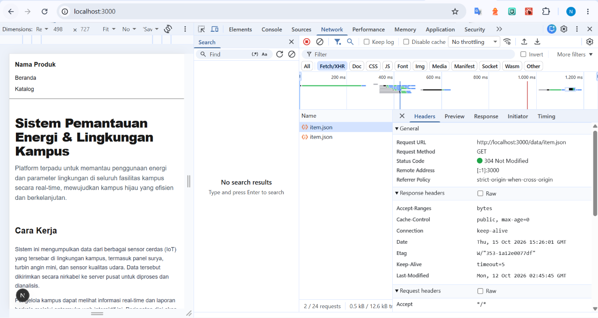
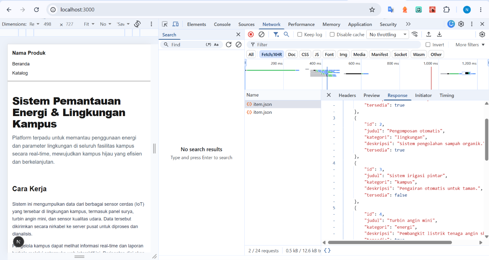

# Dokumen Teknis Modul 3 — TypeScript dan Komponen React
Nama/NIM : Neila Faaizah Asynur / 105224028   
Repositori : [https://github.com/neilaasynur/105224028_PengWeb](https://github.com/neilaasynur/105224028_PengWeb)
## 1. Tipe Data Produk
### a. Isi lib/tipe.ts 
export type Kategori = "energi" | "lingkungan" | "kampus";

export interface Item {
    id: number;
    judul: string;
    kategori: Kategori;
    deskripsi: string;
    tersedia: boolean;
    gambar?: string;
}
### b. alasan pemilihan union type serta properti opsional   
Union type pada kategori digunakan karena nilai kategori hanya diperbolehkan diisi diantara 3 kemungkinan yang tetap. Dengan union type, TypeScript akan memberikan error jika ada nilai lain yang diisi selain 3 kemungkinan string yang dituliskan.   
Properti opsional pada gambar digunakan karena tidak semua item memiliki gambar. Dibandingkan mengisi dengan nilai null, preperti opsional akan membuat tipe yang lebih jujur.   
## 2. Struktur Komponen
app/layout.tsx (Server)
├── SiteHeader (Server)
├── app/page.tsx — Beranda (Server)
│   ├── Bagian (Server)
│   └── ItemTerbaru (Client)
└── app/katalog/page.tsx — HalamanKatalog (Server)
    ├── Bagian (Server)
    └── DaftarItem (Client)
        └── KartuItem (Server/dirender dalam Client)
SiteFooter (Server)
   
- Tabel komponen: nama, props dan tipenya, tempat digunakan
| Nama Komponen | Props | Tipe Props | Digunakan di |
|---|---|---|---|
| `SiteHeader` | `namaProduk`, `tautan` | `string`, `Tautan[]` | `layout.tsx` |
| `SiteFooter` | `namaProduk` | `string` | `layout.tsx` |
| `Bagian` | `id`, `judul`, `children` | `string`, `string`, `React.ReactNode` | `page.tsx`, `katalog/page.tsx` |
| `ItemTerbaru` | _(tidak ada)_ | — | `app/page.tsx` |
| `DaftarItem` | `items` | `Item[]` | `katalog/page.tsx` |
| `KartuItem` | `item` | `Item` | `DaftarItem.tsx` |
## 3. State dan Interaksi

Betikut contoh tangkapan layar ketika kata kunci dan filter di ubah ubah   

Hal ini terjadi ketika user menginputkan sesuatu, maka akan memanggil onChange. Kemudian akan mengubah inputan menjadi kata kunci baru. React akan menjadwalkan ulang dan DaftarItem akan dirender kembali. Variabel hasil akan dihitung kembali dengan menggunakan filter terbaru dan tampilan daftar kartu akan ikut berubah.   
Hal ini juga serupa saat user menekan tombol filter. setFilter akan panggil dan dirender ulang, kemudian cocokKategori akan dievaluasi ulang.
## 4. Pengambilan Data   

### Hasil pengujian kondisi
| Kondisi | Cara menguji | Hasil |
|---|---|---|
| **Memuat** | Throttle jaringan ke "Slow 3G" di tab Network | Teks _"Memuat data…"_ ditampilkan |
| **Berhasil** | Jaringan normal, reload halaman | 3 item pertama muncul dalam daftar |
| **Gagal** | Klik kanan `item.json` → _Block request URL_, lalu reload | _"Data gagal dimuat. Muat ulang halaman."_ ditampilkan |
## 5. Verifikasi   
Berikut tangkapan layar dari npx tsc --noEmit dan npm run lint

## 6. Kendala dan Penyelesaian
Tidak ada kendala
## 7. Catatan Pemanfaatan AI
Pada praktikum ini, saya menggunakan AI Antigravity untuk membantu menyelesaikan dokumen teknis ini. Berikut prompt yang saya gunakan: "Bisakah kamu membantu saya memahami perbedaan dari union type dan properti opsional?" 
